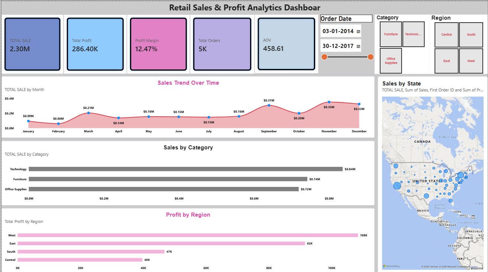

# | Retail Sales & Profit Analytics Dashboard | 

## Project Overview
This project analyzes [ retail sales data from 2023–2025] using
**Microsoft Power BI** to uncover trends in [e.g., revenue, profit, and customer behavior].

## Dashboard Preview

## Files Included
* **`[Screenshot 2026-11-21 162646].png`** – Exported PDF version of the complete Power BI report.
* **`[project-Retail Sales & Profit Analytics Dashboar].pbix`** – Interactive Power BI Desktop file.
* **`[Sample- Superstore].csv`** – Raw dataset used for the analysis.

## Tools & Skills Used
* **Power BI Desktop** (Data Modeling, DAX Measures, Interactive Visuals)
* **Power Query** (Data Cleaning & Transformation)
* ** CSV** (Data Source)

## Key Insights
* **[Insight 1]:** [e.g., Total sales reached $1.2M, with Q4 generating 35% of annual revenue.]
* **[Insight 2]:** [e.g., The Technology category had the highest profit margin at 22%.]
* **[Insight 3]:** [e.g., Top 3 regions accounted for 60% of total orders.]

## How to View
1. Click on the below link to view the full report directly in your browser.
   https://drive.google.com/file/d/1r3V_khJCDGo4gB8qFnKRLFOwHftasJ5d/view?usp=sharing
3. To interact with the dashboard, download the **`.pbix`** file and open it in **Power BI Desktop**.
